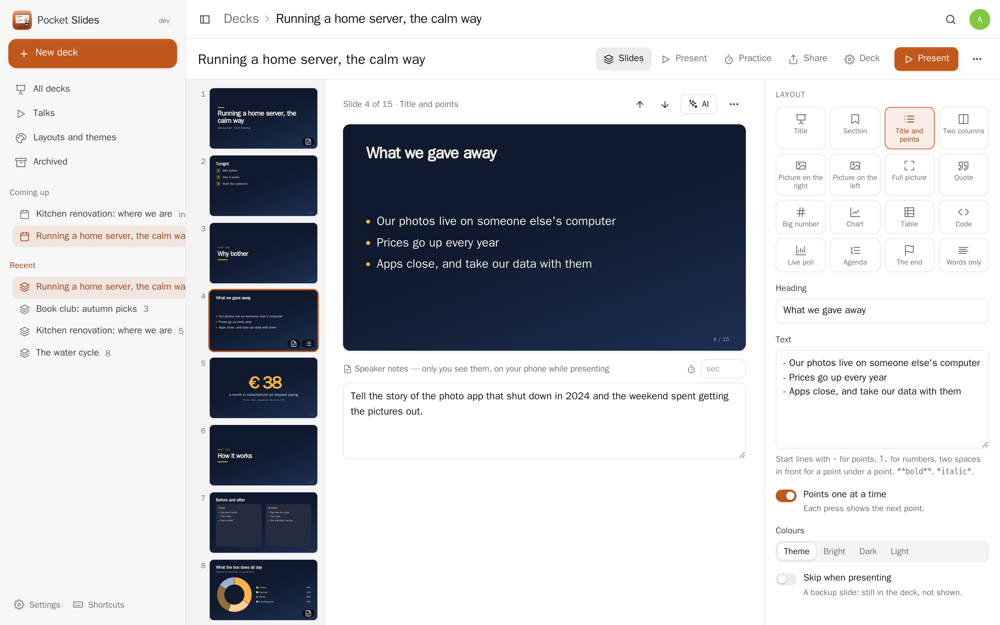
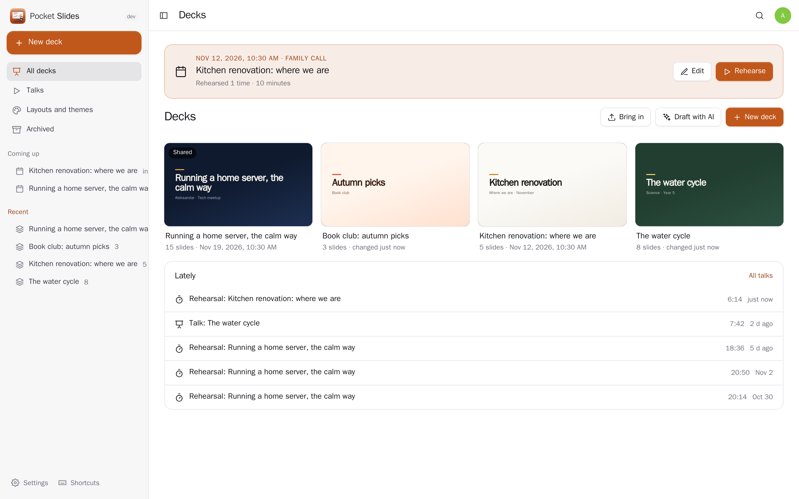
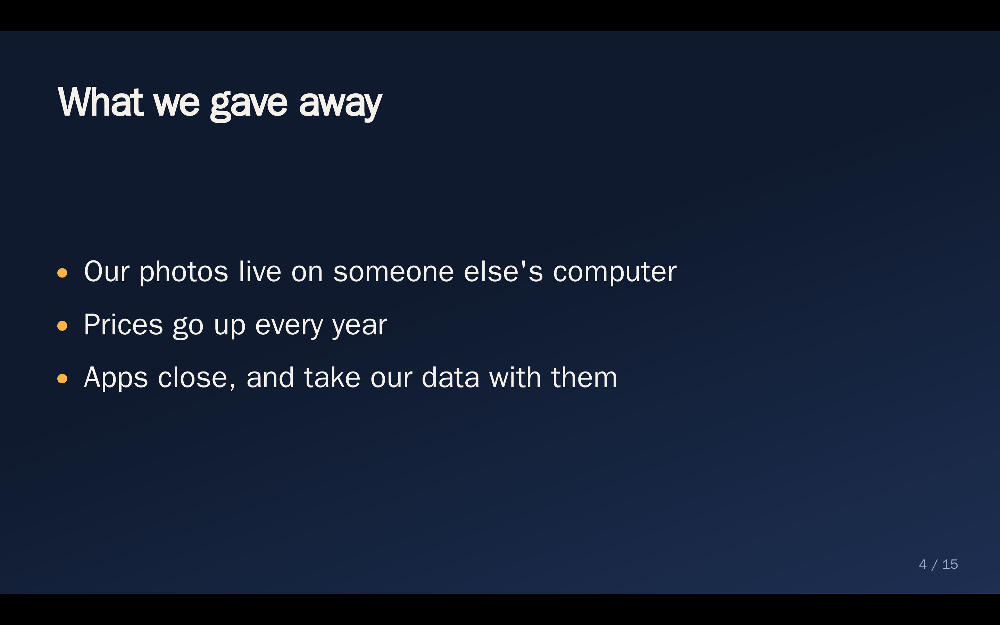
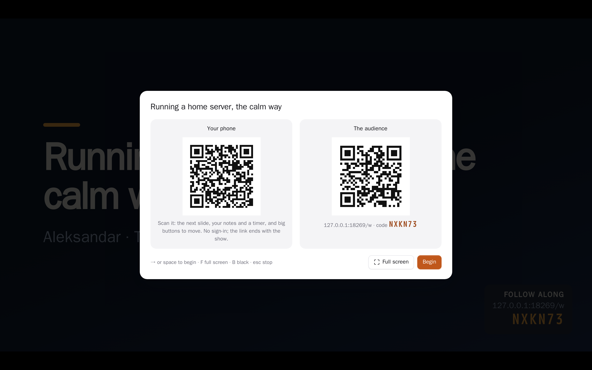
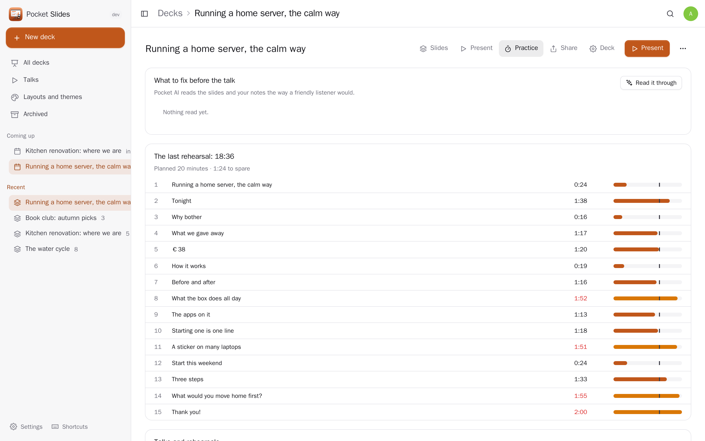
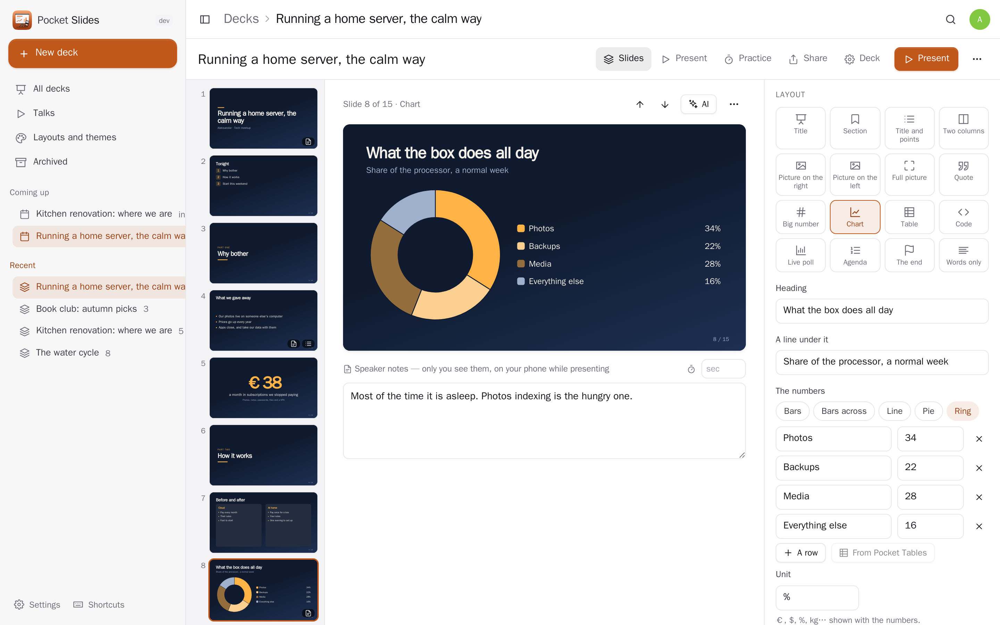
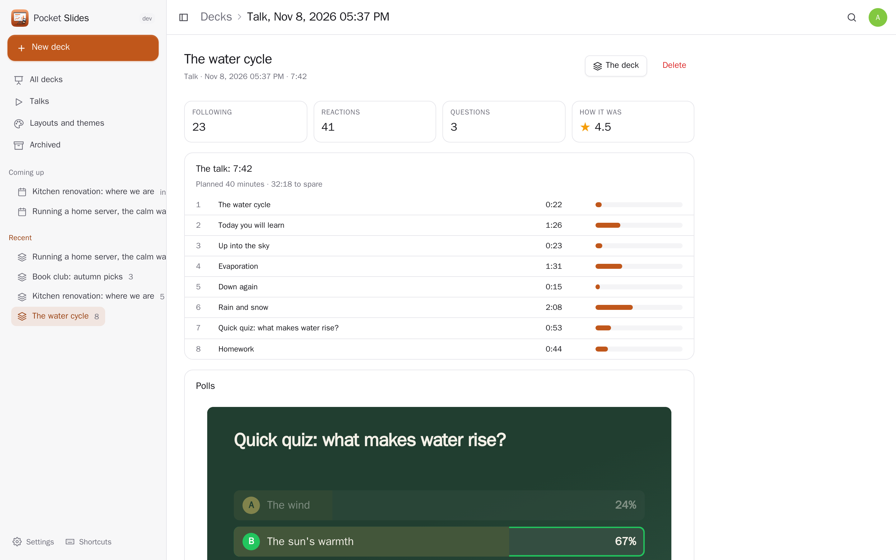
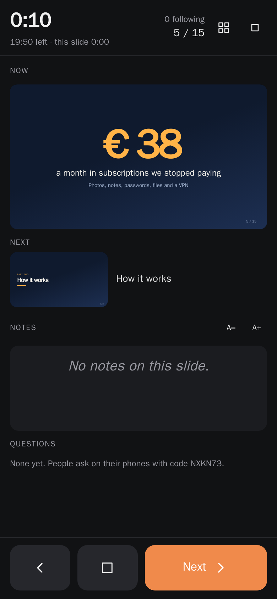
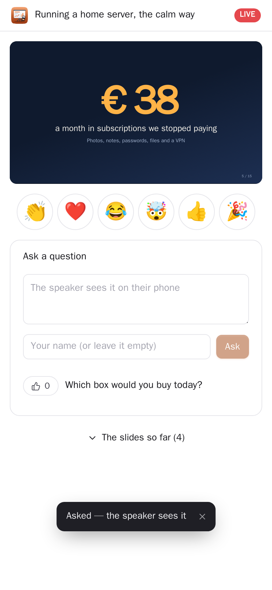
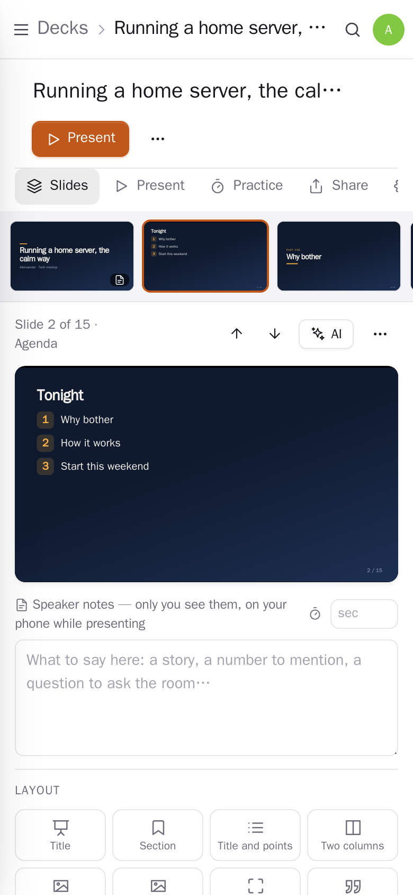

<p align="center"></p>

<h1 align="center">Pocket Slides</h1>

<p align="center">Presentations you make and give from your own server: reusable slide layouts and themes, speaker notes on every slide, and a presenter screen on your phone — the slide on the screen, the next one, your notes and a timer — scanned from a code on the big screen. The audience follows along on their phones, answers live polls and asks questions; you rehearse with a timer per slide and see where you run over. Bring decks in from PowerPoint or Markdown; share a read-only link, print to PDF or save one web page that opens anywhere. Replaces PowerPoint, Keynote or Google Slides for everyday talks, lessons and updates.<br>One Go binary, one SQLite file, one volume. Part of the Pocket apps; works on its own too.</p>

<p align="center">
  <a href="https://github.com/abjelosevic88/pocket-homelab-slides/actions/workflows/ci.yml"></a>
  <a href="https://github.com/abjelosevic88/pocket-homelab-slides/pkgs/container/pocket-homelab-slides"></a>
  <a href="LICENSE"></a>
</p>

<p align="center"></p>

<table>
  <tr>
    <td width="50%"></td>
    <td width="50%"></td>
  </tr>
  <tr>
    <td width="50%"></td>
    <td width="50%"></td>
  </tr>
  <tr>
    <td width="50%"></td>
    <td width="50%"></td>
  </tr>
</table>

<table>
  <tr>
    <td width="33%"></td>
    <td width="33%"></td>
    <td width="33%"></td>
  </tr>
</table>

## What it does

- **Slide layouts.** Title, section, points, two columns, picture left/right/full, quote, big number, chart (bars, line, pie, ring), table, code, live poll or quiz, agenda (made from your section slides), the end (with a code to scan for the slides) and words only. Every slide is drawn on one fixed canvas and scaled as a whole, so it looks the same in the editor, on the projector, on a phone and in the PDF.
- **Reusable.** Keep any slide as one of *my layouts* and start new slides from it in every deck; make *my themes* (colours, fonts, a logo) on top of ten built-in ones; use a whole deck as a template. Seven deck templates to start from: a talk, a lesson, a project update, a pitch, a photo show, a workshop, or empty.
- **Speaker notes and the presenter screen.** Notes under every slide, only for you. Present full screen; a code on the screen turns your phone into the presenter screen (no sign-in; the link ends with the show): the slide on the screen, the next one, the notes in a size you choose, the time gone and left (it warns before the end), questions from the audience, big next/back/black buttons, the screen kept awake. A laptop gets the same screen in its own window. Points one at a time, a quiz answer revealed with a press, keys, clicks and swipes.
- **The audience.** People follow on their phones with a short code: the slide on the screen and the ones before (never the notes, never what comes next), live polls with results filling in on the screen, questions with "me too", a few reactions floating up on the big screen, and afterwards stars and a comment.
- **Rehearse.** A rehearsal keeps the time of every slide, privately; Practice shows each slide against its share of the minutes you planned, and Pocket AI reads the deck the way a friendly listener would and says what to fix.
- **In and out.** Bring in PowerPoint (.pptx — Keynote and Google Slides save it too: the words, speaker notes and the first picture of every slide) or Markdown (Marp, Slidev and reveal.js style). Share a read-only link, print or save a PDF (with notes, if you like), download one web page that opens anywhere offline, or the outline as Markdown. Export everything as JSON and bring it back (twice changes nothing).

## Run it

```sh
docker run -d --name pocket-slides -p 8080:8080 -v ./data:/data \
  -e BASE_URL=https://slides.example.com -e SECURE_COOKIES=true \
  ghcr.io/abjelosevic88/pocket-homelab-slides:latest
```

Open it and make the first account (that one is the admin). To try it with made-up decks: `DEMO_DATA=true AUTH_MODE=none`. Release binaries for Linux, macOS, Windows and FreeBSD are on the releases page. Settings: [docs/configuration.md](docs/configuration.md), API: [docs/api.md](docs/api.md), backup: [docs/backup.md](docs/backup.md), reverse proxy: [docs/reverse-proxy.md](docs/reverse-proxy.md). The audience and phone pages are on the same address, so an audience outside your network needs to be able to reach it.

## With Pocket Core

Set `CORE_URL` and `CORE_REGISTRATION_KEY` and Slides joins the box: people sign in with Pocket Core, Pocket AI helps, and through app links (each person switches them on) it reaches the other Pocket apps — every one optional, greyed out with what to do when it is not there:

| App | What for | Scopes |
|---|---|---|
| Pocket Notes | a deck from a note (each heading a slide); a deck with its speaker notes as a note | `notes:read`, `notes:write` |
| Pocket Photos | your photos on slides, or a photo show from a few | `photos:read` |
| Pocket Files | bring in a PowerPoint, Markdown file or picture; save a deck as a web page or outline | `files:read`, `files:write` |
| Pocket Calendar | the talk in your calendar with the link to its slides; pick the talk from what is on | `calendar:read`, `calendar:write` |
| Pocket Tasks | rehearse twice and send the slides afterwards, as tasks | `tasks:write` |
| Pocket Chat | the slides, or the follow-along link, to a chat | `chat:read`, `chat:write` |
| Pocket Email, Contacts | email the slides to the people who came, picked from your address book | `mail:send`, `contacts:read` |
| Pocket Voice | talk it through in a voice memo, get a first draft | `voice:read` |
| Pocket Tables | a chart or a table slide from one of your tables | `tables:read` |
| Pocket Translate | a copy of a deck, notes included, in another language | `translate:run` |
| Pocket Blog | the talk as a post draft, your notes as the words | `blog:write` |
| Pocket Learn | a lesson's slides and quiz questions as flashcards | `learn:write` |
| Pocket Alerts | the day before a talk; the questions you did not get to | `alerts:write` |

Other apps use your decks through `slides:read` (decks, slides, notes, talks and rehearsals — Pocket Day, Search, AI) and `slides:write` (make a deck with slides, add slides — Pocket AI; an app changes only what it made, and never presents, shares or deletes). Events for Pocket Flows: `slides.deck_created`, `slides.presented`, `slides.rehearsed`, `slides.shared`.

## Develop

```sh
make run      # build the web app and the binary, start with demo data on :8080
make dev      # Go server + Vite dev server
make test     # go vet, go test, tsc
```

Go 1.26, `modernc.org/sqlite` (no CGO), chi; React 19, TypeScript, Vite. `scripts/screenshots.mjs` takes the README pictures and walks through editing, presenting from the phone and following as the audience in a real browser.

MIT © 2026 Aleksandar Bjelosevic
